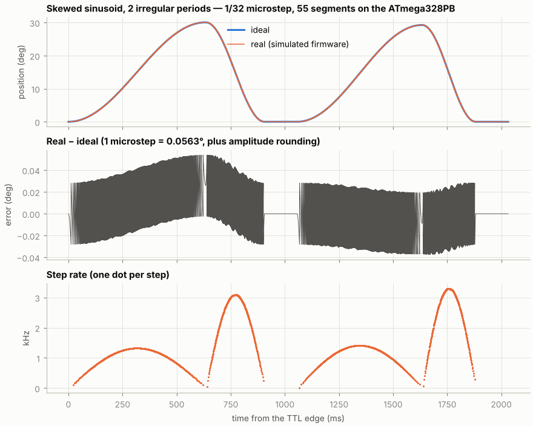

# Dynamic MRI Phantom Controller

Stepper-motor controller that moves an MRI phantom with known, repeatable
motion, to validate dynamic MRI reconstruction (golden-angle radial,
compressed sensing, …).

The controller is armed before the sequence and starts on the **first rising
edge of the scanner's TTL**, which is time zero of the ground truth. The PC
computes the exact time of **every step** and simulates the firmware bit for
bit; the microcontroller only plays the schedule back from a hardware timer.
The motion is therefore known to the microsecond relative to the TTL.



## Documentation

**[hakkelt.github.io/DynamicMriPhantom](https://hakkelt.github.io/DynamicMriPhantom/)**

| Page | Contents |
|---|---|
| [Overview](docs/index.md) | System, scan workflow, quick start, hardware |
| [Trajectory format](docs/trajectory.md) | Shapes, step placement, the 15-byte segments, `.phtraj` files |
| [Main window](docs/gui.md) | Connecting, microstep mode pins, triggers, upload/arm/stop, streaming, ground truth export |
| [Trajectory designer](docs/designer.md) | Parameters, plots, and how microstep, tick and segments are optimized |
| [Firmware](docs/firmware.md) | Timer player, state machine, serial protocol, streaming, timing, emulators |

## Quick start

```bash
pip install -r python_serial/requirements.txt     # numpy, matplotlib, pyserial, pytest
python python_serial/phantom_gui.py
```

1. **Designer…**: choose the shape and parameters, **Compile**, then **Use in
   main window**.
2. Select the port and **Connect**. The trajectory is checked against the
   device.
3. Set the driver's microstep mode pins (DIP switch or jumpers) as shown and
   tick **Mode pins are set as shown**.
4. Keep the trigger on **MRI TTL**, set the cycles, **Upload**, **Arm / Start**,
   then start the sequence.
5. **Export ground truth…** writes the position after every step vs the time
   from the TTL edge.

Flash `arduino_firmware/segment_player/segment_player.ino` with the Arduino
IDE or arduino-cli (ATmega328PB via MiniCore, or ESP32-S3 with USB CDC on
boot). Board settings are in
[arduino_firmware/Notes.txt](arduino_firmware/Notes.txt).

> **ESP32 status:** the ESP32 path passes the same end-to-end tests as the AVR
> in a host simulation, but it has **not** been tested on hardware.

## Layout

| Path | What |
|---|---|
| `arduino_firmware/segment_player/` | Firmware: `segment_player.ino` + `seg_engine.h` (plain C++, also used by the host test) |
| `python_serial/phantom_core.py` | Shapes, step times, segment fitting, firmware simulator, planner, file format (numpy only) |
| `python_serial/phantom_device.py` | Serial protocol and streaming (real port or `socket://` URL) |
| `python_serial/phantom_gui.py` | Main window |
| `python_serial/phantom_designer.py` | Designer window |
| `python_serial/phantom_style.py` | Shared look of both windows |
| `emulator/` | ATmega328P (avr8js) and ESP32-S3 (host simulation) emulators |
| `docs/` | This documentation; `python docs/make_figures.py` regenerates the figures |
| `tests/` | Unit, host cross-check, emulator end-to-end and GUI tests |

## Tests

```bash
npm ci --prefix emulator/avr && emulator/build_avr.sh   # avr-gcc + avr-libc, Node >= 18
emulator/build_esp32.sh                                  # optional: built on demand
xvfb-run -a python -m pytest -v                          # or plain pytest without the GUI tests
```

- `test_core.py`: shapes, step placement, segment fitting, planner, streaming
  model, file round trip, CRC.
- `test_engine_cross.py`: `seg_engine.h` compiled with g++ against the Python
  simulator; event times must be bit-identical.
- `test_emulator.py`: the real firmware on both emulated boards: triggers,
  step timing against the plan, pulse width, DIR setup, cycle length,
  FINISH/STOP/JOG, streaming and the underrun abort.
- `test_gui.py`: both windows under Xvfb, including a run against the
  emulator.

GitHub Actions runs all of this, compiles the sketch with arduino-cli for the
Uno, the ATmega328PB and the ESP32-S3, and publishes the documentation.
