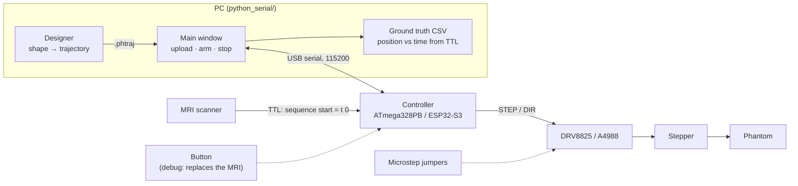
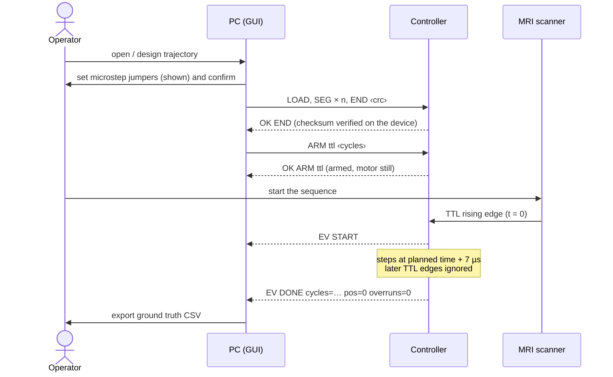
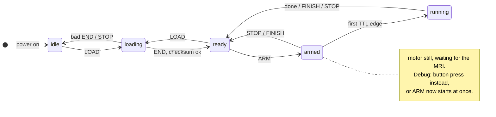
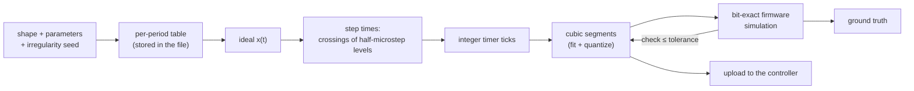
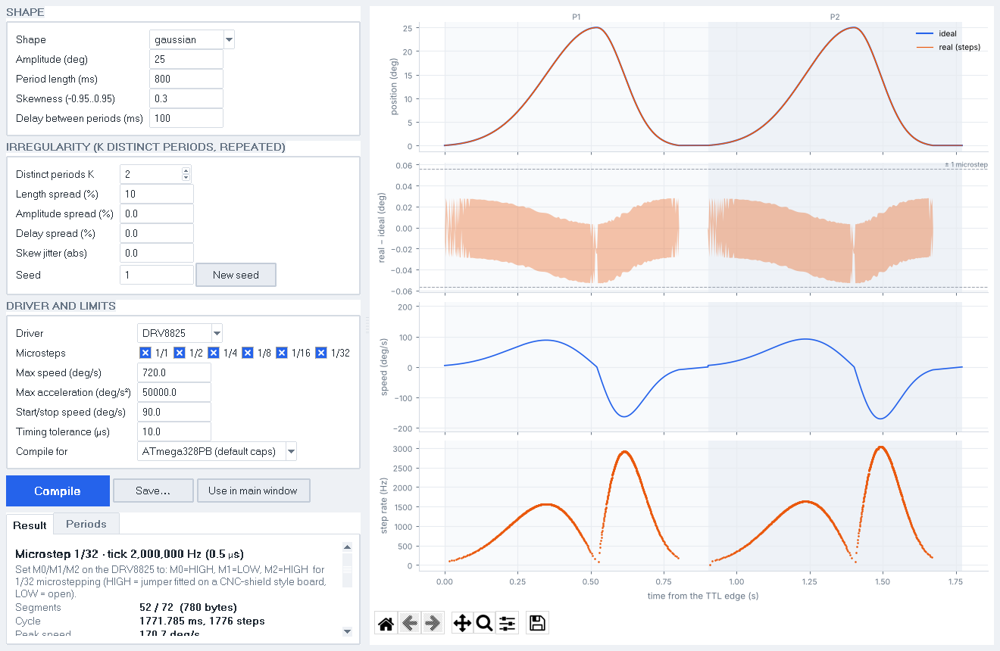
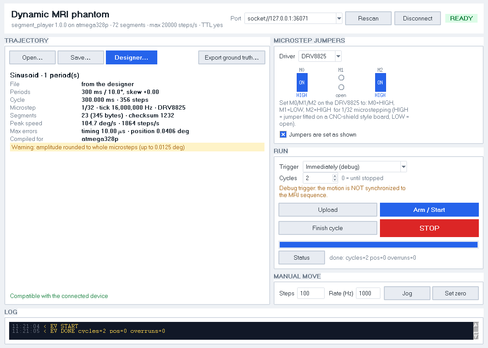
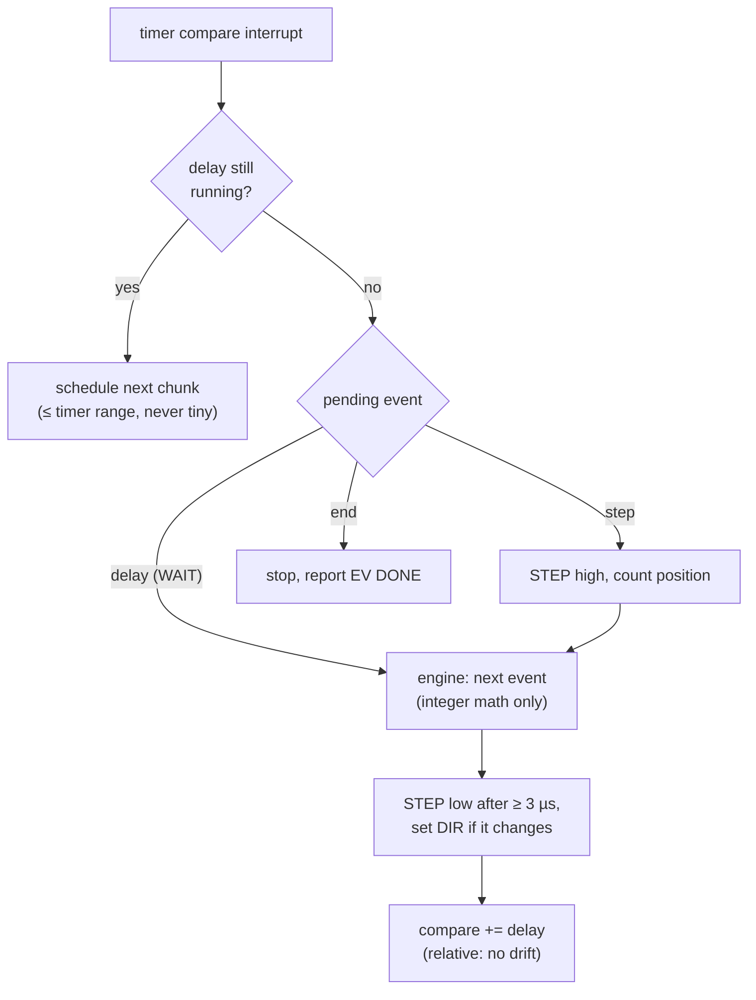

# How the phantom controller works

The phantom must move along a **known** trajectory, **synchronized with the MRI
sequence**, so the motion can serve as ground truth for the reconstruction.
Two things make that possible:

1. **Time zero is the MRI TTL.** The scanner sends a TTL pulse when the sequence
   execution starts. The controller is armed beforehand and starts the motion
   on the first rising edge; later edges are ignored. Every position is defined
   relative to that edge.
2. **Every step is planned on the PC.** The PC computes the exact time of each
   step and simulates the firmware bit for bit. What the simulation says is
   what the motor does, to the microsecond.


*Measured on the emulated ATmega328P: the motion starts at the first TTL edge,
a later edge is ignored, and each step comes 7 µs (constant) after its planned
time.*

## System



| Trigger | Use | Time zero |
|---|---|---|
| **`ttl`** (default) | **Scanning.** Armed before the sequence; starts on its first TTL rising edge. | The TTL edge. Ground truth is valid. |
| `button` | **Debug only:** replaces the MRI during development (bench, no scanner). | The button press (debounced, ~ms jitter). |
| `now` | **Debug only:** starts as soon as it is armed. | The ARM command. |

The GUI shows a warning whenever a debug trigger is selected.

## A scan, step by step



Before a scan, check: jumpers confirmed, trigger = **MRI TTL**, cycles set (0 =
until FINISH/STOP), and that `EV DONE` reports `overruns=0`. **FINISH** ends at
the end of the current cycle (back at 0); **STOP** stops at once (use **Jog** to
return to 0).

## Firmware state machine



`running` ends with `EV DONE`: after the last cycle, at the end of the current
cycle after FINISH, or at once after STOP. **JOG** runs a constant-speed move
from idle/ready and returns there. LOAD, ARM and JOG are refused (`ERR busy`)
while armed or running, and JOG/ZERO while loading. `STATUS` reports the state, cycle,
position and overruns at any time.

## From a design to steps




- **Shapes:** skewed sinusoid (zero velocity at the ends and the peak), skewed
  Gaussian (width set by the period: each end at 3σ) and skewed triangle (constant
  speed per ramp). Up to 5 distinct periods can repeat with a seeded spread.
- **Planner:** largest microstep the device and driver can play, finest timer
  tick within the timing tolerance (default 10 µs), segment count within the
  device memory. You set the microstep with jumpers; the GUI shows the pin levels.
- **Segment** (15 bytes): `count`, `interval`, `add`, `add2` (16.16 fixed-point
  ticks), `flags` (DIR, WAIT). For each step:

  ```
  wait (frac + interval) >> 16 ticks, keep the low 16 bits in frac, step
  interval += add;  add += add2
  ```

  WAIT segments are pure delays (dwell, long gaps). `frac` resets every cycle,
  so all cycles are identical and the cycle length is exact in ticks.

## The two windows

The **designer** shapes the motion and compiles it for a device. Each period is
a band (P1, P2, …), the error panel shows the step quantization envelope
against ±1 microstep, and the dashed lines in the speed panel are the speed
limit. The Result tab shows what the planner chose and what else it tried.



The **controller** window connects to the board, shows the jumper setting for
the chosen microstep as a header diagram, uploads, arms and stops. The badge
top right is the device state (offline, idle, loading, ready, armed, running).



## Inside the controller



Each compare value is set relative to the previous one, so interrupt latency
never accumulates. A compare that would already be in the past is counted as
an **overrun** (reported in `STATUS` and `EV DONE`; it should always be 0).

## Ground truth

**Export ground truth…** in the main window writes one cycle as CSV:
`time_s` (from the TTL rising edge, including the device's constant trigger
latency) and `position_deg` after every step. Cycle *k* is the same, shifted by
*k* × the cycle length (in the header). This is the motion the firmware plays:
the emulator test checks it against the measured STEP edges (< 1 µs).

| Measured (emulated ATmega328P, 16 MHz) | Value |
|---|---|
| TTL edge → planned step time | +7 µs, constant (`trigger_latency_us` in CAPS) |
| Step timing jitter | < 0.5 µs; up to ~2 µs while the controller sends a serial message (it never accumulates) |
| STEP pulse width | ~23 µs (drivers need ≥ 1.9 µs) |
| Segment memory | 72 segments (one smooth period at 1/32 ≈ 30–70) |

The ESP32-S3 back end passes the same end-to-end tests in a host simulation
(steps exactly on plan, no jitter in the model). Its interrupt latencies are
modelled, not measured.

Still to validate on real hardware: STEP/DIR with a logic analyser against the
plan, the driver current limit (lost steps are mechanical), and the ESP32
timing (trigger latency).

## Where to look

| | |
|---|---|
| Protocol, file format, build, tests | [../README.md](../README.md) |
| Board pins and settings | [../arduino_firmware/Notes.txt](../arduino_firmware/Notes.txt) |
| Regenerate these figures | `python docs/make_figures.py` (needs the emulator) |
