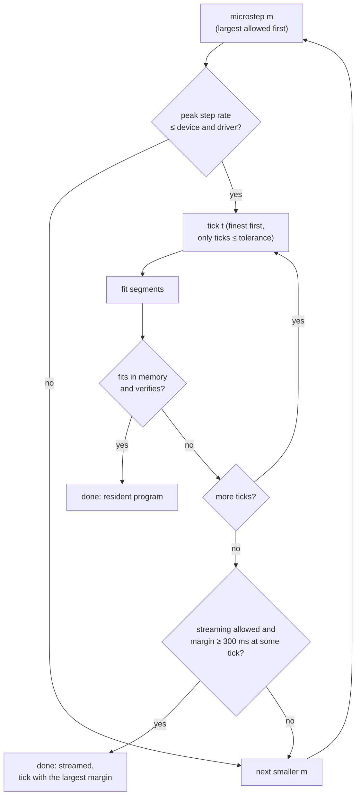
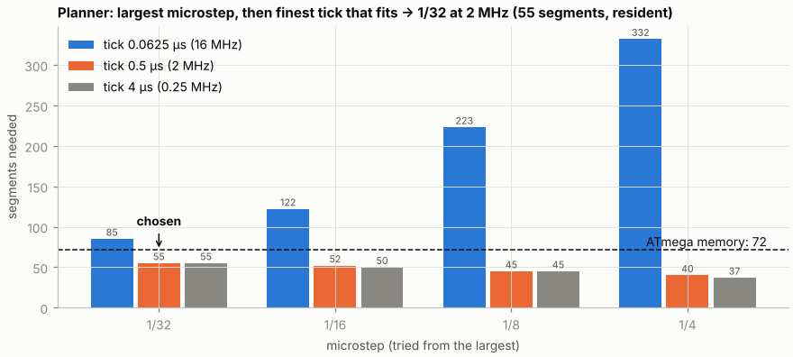

# Trajectory designer

```bash
python python_serial/phantom_designer.py        # or "Designer…" in the main window
```

The designer turns a shape and its parameters into a compiled trajectory for
one device. It shows exactly what the firmware will play.


## Inputs

| Card | Parameters |
|---|---|
| **Shape** | Shape (sinusoid, Gaussian, triangle), amplitude (deg), period length (ms), skewness (−0.95 … 0.95), delay between periods (ms) |
| **Irregularity** | Distinct periods K (1–5), spread of length, amplitude and delay (%), skew jitter, seed (**New seed** draws another) |
| **Driver and limits** | Driver (DRV8825, A4988), allowed microsteps, max speed, max acceleration, start/stop speed, timing tolerance (default 10 µs), target device |

The target is the connected device (its real capabilities) or the default
capabilities of the ATmega328PB or ESP32-S3, for working offline. Shapes and
the step placement are described in [Trajectory format](trajectory.md).

## Outputs

- **Plots**: ideal vs real position with the periods as bands (P1, P2, …),
  the error envelope against ±1 microstep, and the speed with the speed limit
  as dashed lines.
- **Result** tab: the chosen microstep, tick, segment count and memory,
  streaming margin, peak speed, acceleration and step rate, max timing and
  position errors, mode-pin setting, warnings, and every combination the
  planner tried.
- **Periods** tab: the generated per-period table.
- **Save…** a `.phtraj`, or **Use in main window →**.

Limit violations (speed, acceleration, start/stop speed, triangle corners) are
**warnings**: they are shown but do not block compiling. Device limits (step
rate, memory, event spacing) are hard.


## How the trajectory is optimized

The goal is the **finest motion** (largest microstep) with the **most exact
timing** (finest tick) that the device can play from its memory.





*Segments needed per microstep and tick for a two-period sequence on the
ATmega. The finest tick (16 MHz) needs more segments: a step interval is
limited to 60 000 ticks (3.75 ms at 16 MHz), so slow steps need extra WAIT
segments. 1/32 at 2 MHz is
the first combination that fits in 72 segments.*

### Fitting the segments

The step times become timer ticks, and the fitter turns them into
[segments](trajectory.md#segments) greedily from the first step:

1. **Longest segment first.** For the steps that follow, try a segment of
   1, 2, 4, 8, … steps, then bisect to the longest count that still passes.
   A segment never crosses a direction change.
2. **Fit a cubic** to the step times of that run, with least squares and then
   six Lawson passes (iteratively reweighted least squares) that move the fit
   towards the minimax solution, since the tolerance is a maximum error.
3. **Quantize and check exactly.** Round the coefficients to 16.16 fixed
   point, rerun the firmware's integer arithmetic, and accept the segment only
   if every step is within the tolerance and no two events are closer than
   the device's minimum spacing (plus the DIR setup time after a reversal).
4. Gaps longer than the timer range become WAIT segments. A final WAIT makes
   the cycle length exact.

The whole program is then **verified** by simulating the firmware for one
cycle: step count, directions, the timing error of every step, event spacing
across the cycle wrap, and the exact cycle length. The ground truth is this
simulation.

### Streaming decision

At a given microstep, a program that fits in memory always wins. If none
fits, the planner checks whether it can be streamed. It models the serial
link and the deadline of every segment, and requires the PC to stay at least
**300 ms** ahead (`min_stream_slack_ms`) using at most 80 % of the link. Among
the ticks that pass, it picks the one with the largest margin. Set
`allow_streaming=False` to fall back to a smaller microstep instead. See
[Firmware → Streaming](firmware.md#streaming).
