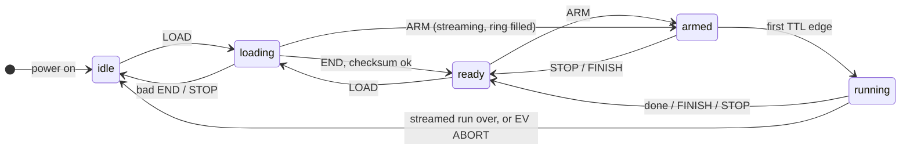
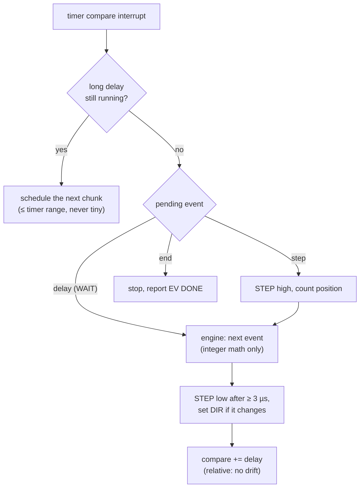
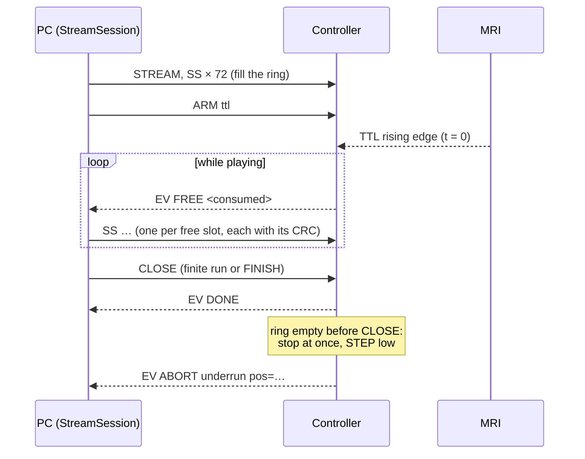
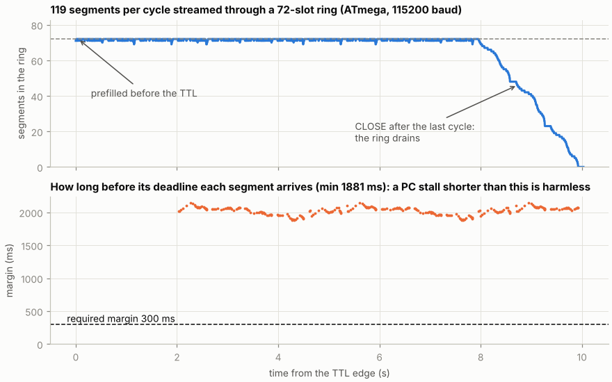

# Firmware

`arduino_firmware/segment_player/` is one sketch for both boards:

- `segment_player.ino` holds the serial protocol, the timer and the pins;
- `seg_engine.h` is the segment engine in plain C++, also compiled on the PC
  for the bit-exact cross-check.

The firmware does no floating-point math and no planning. It plays the
integer schedule from a hardware timer.

| | ATmega328PB | ESP32-S3 |
|---|---|---|
| Timer | Timer1, 16 bit, `OCR1A += ticks` | gptimer, 54 bit, absolute alarm |
| Tick rates | 16 MHz, 2 MHz, 250 kHz, 62.5 kHz, 15.6 kHz | 40, 10, 4, 2, 1 MHz |
| Segment memory | 72 (1080 B of 2 KB RAM) | 4096 |
| Max step rate / min event spacing | 20 kHz / 40 µs | 50 kHz / 12 µs |
| Trigger latency (CAPS) | 7 µs (measured in the emulator) | 2 µs (to be measured) |
| Pins DIR, STEP, button, TTL | D2, D3, D5, D6 | 5, 6, 8, 9 |

## State machine



Streaming uses `loading` too: `STREAM` enters it and `SS` lines fill the ring
while it stays there. A streamed program is used up by playing it, so the
device returns to `idle`.

- **ARM with the TTL trigger** waits with the motor still. The button trigger
  waits for a press instead, and `ARM now` starts at once.
- **Running** ends with `EV DONE`: after the last cycle, at the end of the
  current cycle after FINISH, or at once after STOP.
- **JOG** runs a constant-speed move from idle or ready.
- LOAD, ARM and JOG are refused (`ERR busy`) while armed or running.

## Playing the schedule



- One interrupt per event, and the next event is computed while STEP is high.
- Each compare value is set **relative to the previous one**, so interrupt
  latency never accumulates.
- A compare that would already be in the past is counted as an **overrun**,
  reported in `STATUS` and `EV DONE`. It should always be 0.
- DIR changes after STEP falls, at least one event before the next step.
- On the AVR the `millis()` interrupt is paused during playback.

## Trigger and timing

Only the **first** rising edge of the MRI TTL counts. It is caught by a pin
interrupt that starts the timer, so the delay from the edge to the schedule is
constant. The device reports it as `trigger_latency_us`, and it is included in
the ground truth.


| Measured (emulated ATmega328P, 16 MHz) | Value |
|---|---|
| TTL edge → planned step time | +6.9 µs, constant |
| Step jitter | < 0.5 µs; up to ~2 µs while a serial message is sent; never accumulates |
| Step jitter while streaming | ~1 % of steps up to ~7 µs late (serial receive interrupt) |
| STEP pulse width | ~23 µs (drivers need ≥ 1.9 µs) |

## Serial protocol

115200 baud, ASCII lines. `EV …` lines are asynchronous events.

| Command | Reply |
|---|---|
| `HELLO` | `CAPS {json}`: board, clock, timer bits, tick rates, max segments, receive buffer, step rate, event spacing, pulse/DIR timing, trigger latency, pins, triggers |
| `LOAD <nseg> <tick_hz> <cycles> <now\|ttl\|button>` | `OK LOAD` |
| `SEG <count> <interval> <add> <add2> <flags>` | `OK <index>` |
| `END <crc16>` | `OK END <nseg> <crc16>` or `ERR checksum <crc>` |
| `ARM [trigger] [cycles]` | `OK ARM <trigger>`, then `EV START`, `EV DONE cycles=… pos=… overruns=…` |
| `STOP` / `FINISH` | `OK STOP pos=…` / `OK FINISH` |
| `STATUS` | `STATUS state=… cycle=… seg=… pos=… overruns=… stream=… buffered=…` |
| `JOG <steps> <rate_hz>` / `ZERO` | `OK JOG` (then `EV DONE`) / `OK ZERO` |
| `STREAM <tick_hz> <now\|ttl\|button>` | `OK STREAM <slots>` |
| `SS <count> <interval> <add> <add2> <flags> <crc16>` | `SS <seq>`, or `ERR SS crc\|full\|closed\|…` |
| `CLOSE` | `OK CLOSE` |
| (streaming events) | `EV FREE <consumed>`, `EV ABORT underrun consumed=… pos=… cycles=…` |

## Streaming

The ATmega holds 72 segments, but an irregular sequence with several periods
needs 100–400. Those programs are streamed: the segment memory becomes a ring
that the PC keeps filled while the motor plays.





*Planner model for a five-period sequence (119 segments per cycle) on the
ATmega. The ring stays full while playing. Every segment arrives about 2 s
before it is needed, far above the required 300 ms.*

- Each `SS` line carries its own CRC. The first segment of each cycle has
  flag CYCLE, so FINISH still stops at a cycle boundary.
- The PC never has more unacknowledged bytes in flight than the device's
  receive buffer.
- **Underrun safeguard:** if the engine needs a segment and the ring is empty
  before `CLOSE`, the device stops at once and STEP stays low. It reports
  `EV ABORT underrun` with the position and goes idle. A refused or unanswered
  line on the PC side stops the device too (`EV ABORT host …`).

## Emulators

Both boards run in emulators with one interface (`emulator/emulator.py`).
Serial is bridged to a TCP socket, every STEP/DIR/TTL edge is traced, and
`ttl`/`button` inputs can be pulsed. The end-to-end tests run on both.

| | ATmega328P | ESP32-S3 |
|---|---|---|
| How | Unmodified firmware in [avr8js](https://github.com/wokwi/avr8js), cycle accurate | ESP32 code path compiled for the host against API stand-ins, virtual 240 MHz clock |
| Build | `npm ci --prefix emulator/avr && emulator/build_avr.sh` | `emulator/build_esp32.sh` |
| Run | `python emulator/emulator.py` | `python emulator/emulator.py --board esp32s3` |
| Limits | Exact timing | Interrupt latencies are modelled, not measured |

```bash
python python_serial/phantom_gui.py --port socket://127.0.0.1:5555
```

Type `ttl` or `button` in the emulator terminal to pulse the inputs.
`build_avr.sh` needs avr-gcc and avr-libc (set `AVR_GCC_BIN` if they are not
on `PATH`) and fetches ArduinoCore-avr into `.deps/`. The AVR harness works
around an avr8js 0.21.1 bug that drops a pending RX interrupt on a write to
UCSR0B.

**Still to validate on hardware:** STEP/DIR with a logic analyser against the
plan, the driver current limit (lost steps are mechanical), and the ESP32
trigger latency.

## Possible improvement: hardware step edges (ATmega)

*Not implemented: the existing PCB has STEP on D3.*

Today the ISR raises STEP in software, so each rising edge carries the
interrupt entry latency, and while streaming the serial receive interrupt can
delay it by a few µs. Timer1 can instead drive its own pin **D9 (OC1A)** on
the compare match, making every rising edge tick-exact:

- **Long waits** stay chunked as now (`next_chunk`, `g_rem`). Intermediate
  chunks and non-step events use `COM1A = 00` (pin untouched). The ISR that
  schedules the *last* chunk of a step sets `COM1A = 11`, so the hardware sets
  D9 on that match.
- **Falling edge** stays in software: the ISR for that match sets `COM1A = 10`,
  strobes `FOC1A` (forces D9 low) once the minimum pulse width has passed, then
  returns to `COM1A = 00`. Drivers latch on the rising edge, so the fall only
  needs the minimum width.
- **Missed deadline** (existing overrun check): force the pulse with `FOC1A`
  and count the overrun as now. `next_chunk` already keeps the last piece long
  enough to program in time.
- `hw_start_at()` sets the mode for the first event; `hw_stop()` sets
  `COM1A = 00` with PORTB1 low. DIR stays a normal pin written in the ISR.

Needs a board revision (STEP → D9, same pin on the 328PB). The emulator tests
could then demand cycle-exact steps while streaming, provided avr8js models
the compare-output modes and `FOC1A` (to check). The ESP32 is not affected.
