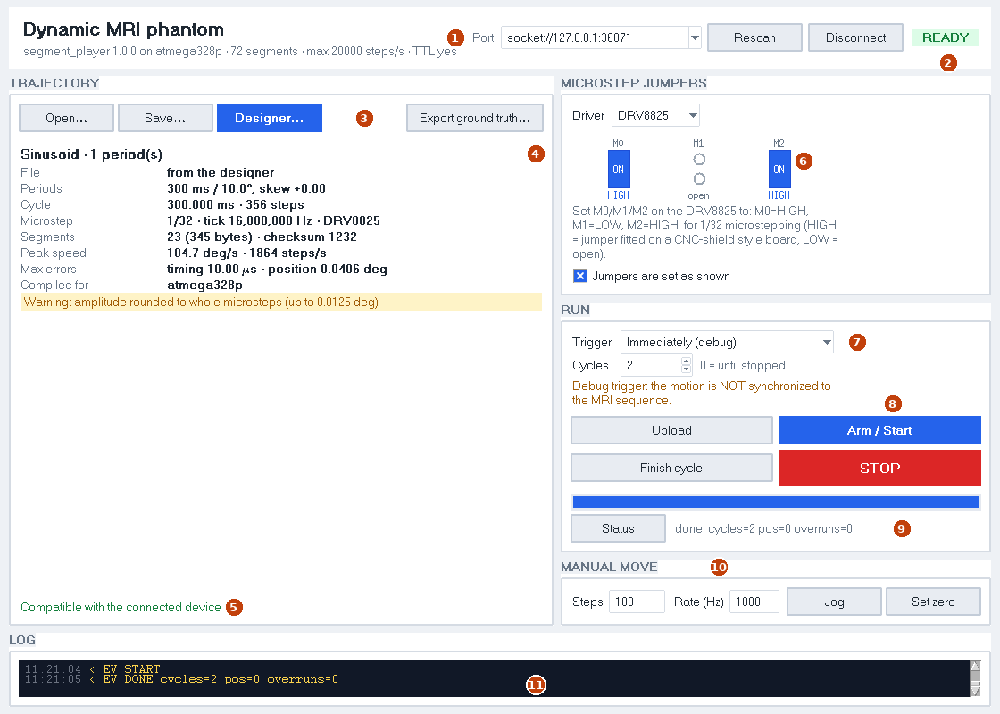
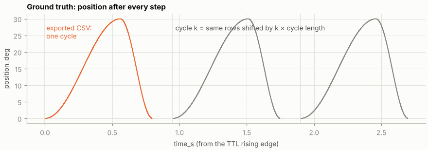

# Main window

```bash
python python_serial/phantom_gui.py [--port PORT] [trajectory.phtraj]
```

The main window runs a scan. It connects to the controller, checks the
trajectory against the device, uploads it, arms it on the MRI TTL and exports
the ground truth. Trajectories come from the [designer](designer.md) or from a
`.phtraj` file.



| # | Feature |
|---|---|
| 1 | **Port**: serial port or a `socket://` URL for the emulator. **Connect** reads the device capabilities (board, memory, tick rates, step rate). |
| 2 | **State badge**: offline, idle, loading, ready, armed, running, ABORTED. |
| 3 | **Open… / Save…** a `.phtraj`, **Designer…**, **Export ground truth…** (CSV). |
| 4 | **Summary**: shape, periods, cycle length, microstep and tick, segments and checksum, peak speed, max errors, streaming margin, and the warnings. |
| 5 | **Compatibility** with the connected device: protocol, tick rate, memory (or a safe streaming margin), step rate, event spacing. Upload is blocked if a check fails. |
| 6 | **Microstep jumpers**: the mode-pin levels for the compiled microstep on the chosen driver (DRV8825: M0–M2, A4988: MS1–MS3). Upload and Arm stay disabled until you tick *Jumpers are set as shown*. Changing the driver or the trajectory clears the tick. |
| 7 | **Trigger** and **Cycles** (0 = until Finish/STOP). The debug triggers show a warning that the motion is not synchronized. |
| 8 | **Upload** (*Fill stream buffer* for streamed trajectories), **Arm / Start**, **Finish cycle** (stops at the end of the current cycle, back at 0) and **STOP** (immediate). |
| 9 | **Progress**: upload progress, or the stream buffer level while playing. **Status** queries the cycle, position and overruns. |
| 10 | **Manual move**: **Jog** a number of steps at a rate, **Set zero**. |
| 11 | **Log** of every line sent (`>`) and received (`<`), with events and errors coloured. |

## Triggers

| Trigger | Use | Time zero |
|---|---|---|
| **MRI TTL** (default) | **Scanning.** Armed before the sequence, starts on its first TTL rising edge. | The TTL edge. Ground truth is valid. |
| Button | **Debug only.** Stands in for the MRI on the bench. | The press, debounced (jitter of a few ms). |
| Immediately | **Debug only.** | The ARM command. |

## Streamed trajectories

A trajectory larger than the device memory (more than 72 segments on the
ATmega) is streamed while it plays. The [firmware page](firmware.md#streaming)
explains how.

- The summary shows **Streaming** with the safety margin.
- *Fill stream buffer* fills the device ring; then arm as usual. Keep the
  PC connected for the whole run.
- While playing, the progress bar shows how many segments the device holds.
- A streamed program is used up by playing it. Fill the buffer again before the
  next run.
- If the PC falls behind, the controller **aborts at once**. The badge turns red
  (**ABORTED**) and an alarm gives the stop position. Jog back to zero before
  the next run, and treat the MRI data after the abort as unsynchronized.

## Ground truth



**Export ground truth…** writes one cycle as CSV with two columns:

- `time_s`: time from the TTL rising edge, including the device's constant
  trigger latency;
- `position_deg`: position right after each step.

The header gives the cycle length; cycle *k* is the same rows shifted by
*k* × the cycle length. This is the firmware's own integer schedule, and the
emulator tests check it against the measured STEP edges (< 1 µs).
