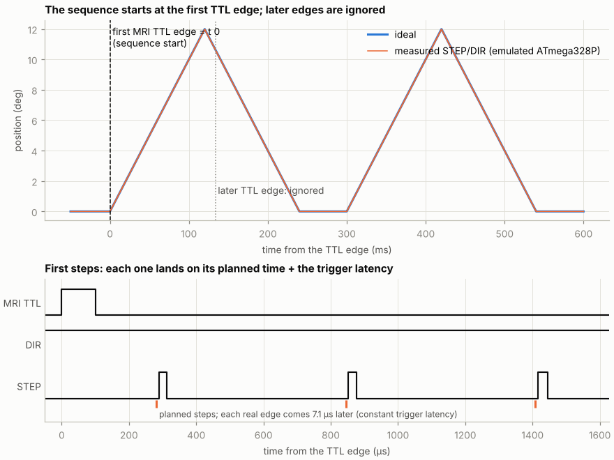
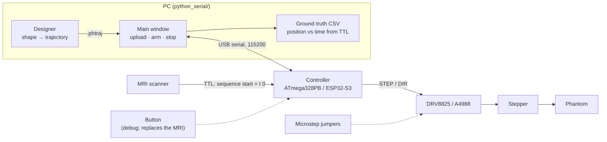
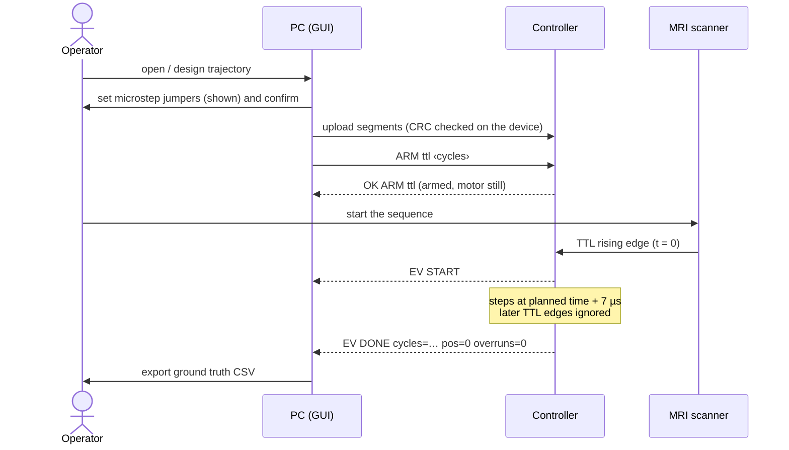

# Dynamic MRI Phantom Controller

A stepper motor moves an MRI phantom along a **known, repeatable** trajectory,
**synchronized with the MRI sequence**. The motion is the ground truth for
validating dynamic reconstructions (golden-angle radial, compressed sensing, …).

1. **Time zero is the MRI TTL.** The controller is armed before the sequence
   and starts on the first rising edge of the scanner's TTL. Later edges are
   ignored.
2. **Every step is planned on the PC.** The PC computes the time of each step
   and simulates the firmware bit for bit. What the simulation says is what the
   motor does, to the microsecond.



*Measured on the emulated ATmega328P: the motion starts at the first TTL edge,
a later edge is ignored, and every step comes a constant 7 µs after its planned
time.*

## System



| Part | Role | Page |
|---|---|---|
| Trajectory | Shapes, step placement, the 15-byte segments the firmware plays | [Trajectory format](trajectory.md) |
| Designer | Shape → step times → segments; picks microstep and timer tick | [Trajectory designer](designer.md) |
| Main window | Connect, check, upload, arm on the TTL, stop, export ground truth | [Main window](gui.md) |
| Firmware | Timer interrupt player, serial protocol, streaming, timing | [Firmware](firmware.md) |

## A scan, step by step



Before a scan, check that the jumpers are confirmed, the trigger is **MRI TTL**
and the cycle count is set (0 = until Finish/STOP). After it, check that
`EV DONE` reports `overruns=0`.

## Quick start

```bash
pip install -r python_serial/requirements.txt     # numpy, matplotlib, pyserial
python python_serial/phantom_gui.py
```

Flash `arduino_firmware/segment_player/segment_player.ino` with the Arduino IDE
or arduino-cli. No board at hand? Run the [emulator](firmware.md#emulators) and
connect the GUI to `socket://127.0.0.1:5555`.

## Hardware

| Board | DIR | STEP | Button | MRI TTL | Segments in memory |
|---|---|---|---|---|---|
| ATmega328PB Xplained Mini (16 MHz) | D2 | D3 | D5 | D6 | 72 (larger programs are streamed) |
| ESP32-S3 Dev Module (USB CDC on boot) | 5 | 6 | 8 | 9 | 4096 |

200 steps/rev stepper with a DRV8825 or A4988 driver. The microstep is set
with jumpers. The button connects to GND. The ESP32 TTL input is 3.3 V, so a
5 V trigger must be level-shifted. The ESP32 path passes all tests in a host
simulation but is **not yet tested on hardware**.
