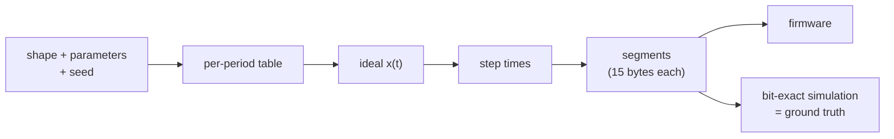
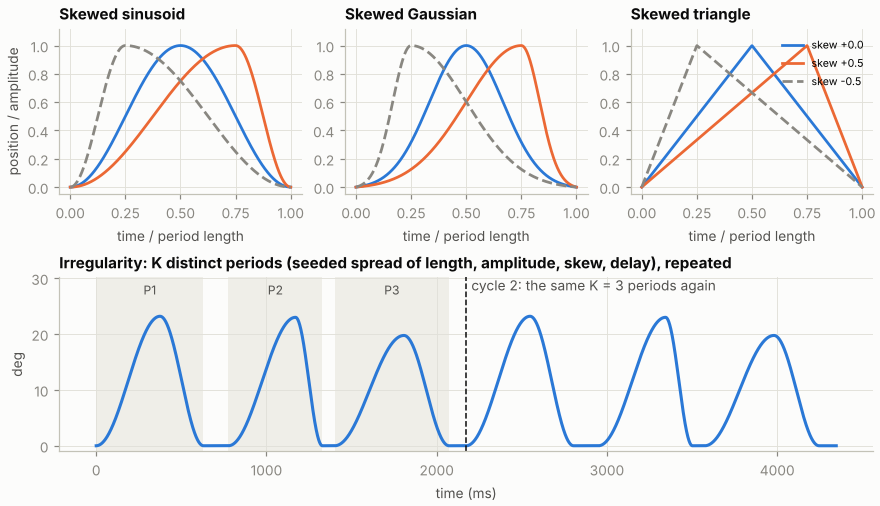
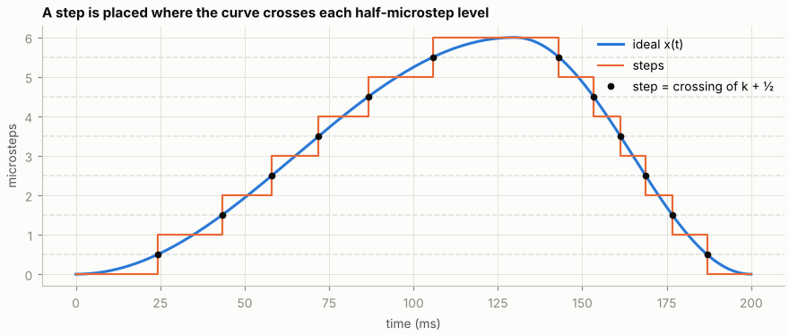
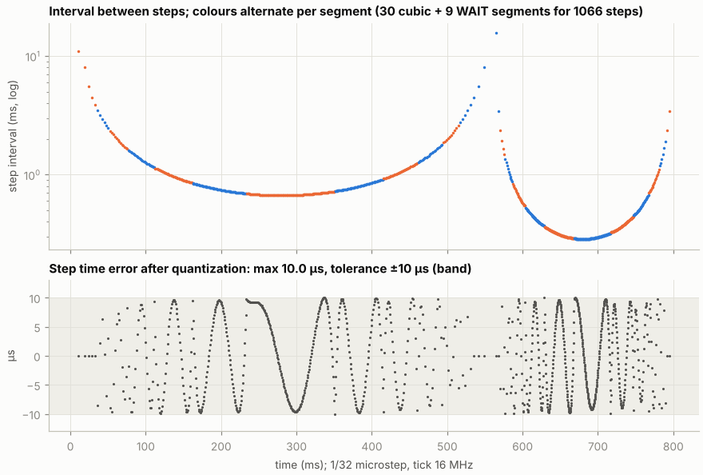

# Trajectory format

A trajectory goes through three representations. The **shape** is a smooth
position curve, the **steps** are the times when that curve crosses a
microstep, and the **segments** are a compact integer encoding of those times
that the firmware plays.



## Shapes and periods



Each period rises from 0 to the amplitude and returns to 0. The peak is at
`a = (1 + skew)/2` of the period.

| Shape | Profile | Ends and peak |
|---|---|---|
| Skewed sinusoid | Half-cosine rise over `[0, a]`, fall over `[a, 1]` | Zero speed at both ends and at the peak |
| Skewed Gaussian | Split normal; each end is 3σ from the peak | Small, non-zero end speed |
| Skewed triangle | Constant speed on each ramp | Speed jumps at the corners (the designer warns) |

A **delay** (dwell at 0) follows each period. **Irregularity** draws K = 1–5
distinct periods from a seed, with a % spread of length, amplitude and delay
and an absolute skew jitter. The K periods repeat every cycle. The generated
per-period table is stored in the file, so a trajectory never depends on the
random generator.

## Steps



The amplitude of each period is rounded to whole microsteps N. A step is placed
where the curve crosses each level k + ½ (k = 0 … N−1), once on the way up and
once on the way down. This gives:

- zero net steps per period, so the phantom always returns exactly to 0;
- no chatter at the peak;
- a position error of at most ½ microstep, plus the timing tolerance.

## Segments

The firmware does not store step times. It stores **segments**, each describing
a run of steps whose interval follows a cubic in the step index.

| Field | Type | Meaning |
|---|---|---|
| `count` | u16 | Steps in the segment |
| `interval` | u32, 16.16 ticks | Interval to the first step |
| `add` | i32, 16.16 | Change of the interval per step |
| `add2` | i32, 16.16 | Change of `add` per step |
| `flags` | u8 | `0x01` DIR, `0x02` WAIT, `0x04` CYCLE (streaming: first segment of a cycle) |

For each step the engine does, with integer arithmetic only:

```
acc      = frac + interval
wait       acc >> 16 ticks, then STEP
frac     = acc & 0xFFFF          # sub-tick remainder carried to the next step
interval += add
add      += add2
```

A **WAIT** segment is a pure delay of `interval` whole ticks. It is used for
dwells and for gaps longer than the timer range. The last segment of a cycle
is a WAIT that makes the cycle length exact in ticks. `frac` is reset at every
cycle start, so all cycles are identical.



*One skewed-sinusoid period at 1/32 microstep. Each colour run is one cubic
segment. 39 segments (30 cubic and 9 WAIT, 585 bytes) encode 1066 steps, all
within ±10 µs of the ideal time.*

The checksum is CRC-16/CCITT-FALSE over the packed little-endian segments. The
device verifies it after an upload.

## File (`.phtraj`)

A compiled trajectory is a JSON file with:

- format name and version;
- microstep, driver, timer tick, steps/rev;
- the designer parameters and limits, and the per-period table;
- the segments, cycle length in ticks, step count and checksum;
- metrics, warnings, and the device capabilities it was compiled for.

The main window checks the stored capabilities against the connected device
before it uploads anything.
